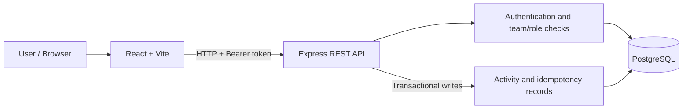

# Operations Under Pressure

**A full-stack operations workspace built around reliable workflows, team-scoped authorization, and correctness under concurrent requests.**

[Repository](https://github.com/Anju31-dot/newtonite-ops) · React + Vite · Node.js + Express · PostgreSQL + Prisma

## Overview

Operations Under Pressure replaces scattered operational requests with a single place to create, prioritize, assign, track, discuss, and resolve work across teams.

This project focuses on more than CRUD: permissions are enforced by the API, important changes are auditable, workflow transitions are validated on the server, and concurrent or repeated requests are handled deliberately.

## Highlights

- **Team-aware access control:** seeded identities, signed expiring JWTs, hashed demo passwords, team memberships, and server-side role/resource checks.
- **End-to-end work-item workflow:** typed work items, priorities, assignments, status transitions, comments, search, filters, sorting, and paginated queues.
- **Concurrency safety:** atomic claims ensure only one competing user can claim an unassigned item; version checks reject stale edits with `409 STALE_VERSION`.
- **Reliable history:** actor-attributed activity records are written transactionally with work-item changes.
- **Idempotent retries:** item creation and comment endpoints support `Idempotency-Key`; matching retries replay the stored response, while key reuse with a different payload returns `409 IDEMPOTENCY_KEY_REUSED`.
- **Approval guardrails:** only a Lead or Admin of the item's team can approve the `Awaiting Approval → Resolved` transition.
- **Tested engineering decisions:** unit/route tests, client tests, and PostgreSQL-backed integration tests cover authorization, workflow rules, stale writes, concurrent claims, and idempotency.
- **Practical local setup:** Docker Compose, Prisma migrations, seed data, a documented API, and repeatable verification commands.

## Architecture



**Stack**
- **Frontend:** React, Vite
- **Backend:** Node.js, Express REST API
- **Data layer:** PostgreSQL, Prisma ORM and migrations
- **Authentication:** bcrypt password hashes and signed JWT bearer tokens
- **Quality:** Node test runner, client tests, PostgreSQL integration tests, production build

## Quick start

### Prerequisites
- Node.js 20.19+ and npm
- Docker Desktop with Compose, or PostgreSQL 14+
- A local JWT secret of at least 32 characters

### 1. Install dependencies and start PostgreSQL

Run from the repository root:

```sh
npm install
docker compose up -d postgres
```

The Compose defaults (`ops_user` / `change_me`) are for local demos only. Do not use them for deployed or sensitive environments.

### 2. Configure the API

```powershell
Copy-Item .env.example server/.env
node -e "console.log(require('node:crypto').randomBytes(32).toString('hex'))"
```

Put the generated value in `JWT_SECRET` in `server/.env`. Set `DATABASE_URL` to your local database and choose a `DEMO_PASSWORD`. Keep local `.env` files out of Git.

### 3. Apply migrations and seed demo accounts

```sh
npm run db:generate
npm run db:migrate
npm run db:seed
```

### 4. Run the application

```sh
npm run dev
```

- **Frontend:** http://localhost:5173
- **API:** http://localhost:4000
- **Health endpoint:** http://localhost:4000/health

The API uses port 4000 by default. Configure `CLIENT_ORIGIN` in `server/.env` if the frontend origin changes. Set `VITE_API_URL` when the API is not available at `http://localhost:4000/api`.

## Demo accounts

The seed creates the following local demo users. They share the password configured by `DEMO_PASSWORD`; the local fallback is `OpsDemo2026!`.

| Email | Team | Role |
|---|---|---|
| `admin@newtonite.demo` | Service Operations | Admin |
| `lead@newtonite.demo` | Service Operations | Lead |
| `member@newtonite.demo` | Service Operations | Member |
| `viewer@newtonite.demo` | Service Operations | Viewer |
| `risklead@newtonite.demo` | Risk & Payments | Lead |

These credentials are intentionally for local demonstration only. Change them before any deployment and never use demo identities for real data.

## Workflow and safeguards

| Behaviour | Implementation |
|---|---|
| Concurrent claim | Conditional database update; only one claimant succeeds |
| Stale edit | Atomic version check and increment; stale writes return `409 STALE_VERSION` |
| Workflow | Server validates allowed status transitions |
| Approval | Lead/Admin role is checked against the item's team |
| Resource access | API checks team membership for every item operation |
| Audit trail | Actor-attributed activity is persisted in the same transaction as changes |
| Duplicate requests | Optional idempotency keys persist the response with the mutation |
| Client conflicts | UI refreshes stale data and asks the user to review before editing again |

### Workflow transitions

- **Open → In Progress**
- **In Progress → Awaiting Approval** or **Resolved**
- **Awaiting Approval → In Progress** or **Resolved**
- **Resolved → Closed** or **In Progress**
- **Closed** has no outgoing transition

Viewers can read items in their teams but cannot mutate them. The API remains authoritative even when a UI control is hidden.

## API at a glance

All routes use the `/api` prefix. Protected routes require `Authorization: Bearer <token>`.

| Method | Route | Purpose |
|---|---|---|
| GET | `/health` | Liveness probe |
| POST | `/auth/login` | Sign in with a seeded demo account |
| GET | `/auth/me` | Current user and memberships |
| GET | `/teams`, `/members` | Accessible teams and members |
| GET | `/items` | Search, filter, sort, and paginate work items |
| POST | `/items` | Create a work item; supports `Idempotency-Key` |
| GET | `/items/:id` | Item detail, activity timeline, and comments |
| PATCH | `/items/:id` | Update fields using the current `version` |
| PATCH | `/items/:id/status` | Request a valid workflow transition |
| PATCH | `/items/:id/assignment` | Assign or unassign an item |
| POST | `/items/:id/claim` | Atomically claim an unassigned item |
| POST | `/items/:id/comments` | Add a comment; supports `Idempotency-Key` |

For retries, callers should reuse the same idempotency key only for the same logical operation and payload. The header is optional for API compatibility; calls without it are not idempotent.

## Tests and verification

Run the main verification commands:

```sh
npm run db:generate
npm test
npm run build
```

The PostgreSQL integration suite requires a **separate disposable database** configured with `TEST_DATABASE_URL`. Follow the detailed, safety-guarded setup in the test section of the source history / test file before running it; never point integration tests at a development or production database.

**Last recorded verification (17 October 2026):**
- Prisma client generation and schema validation: passed
- Server tests, including PostgreSQL integration tests: **48 passed, 0 skipped, 0 failed**
- Client tests: **8 passed, 0 skipped, 0 failed**
- Production build: passed
- PostgreSQL integration tests: **12 passed, 0 skipped, 0 failed** against an isolated test database

These are recorded results from the development session, not a claim that every browser flow was independently re-tested after the latest commit.

## Engineering decisions

See [`ENGINEERING_DECISIONS.md`](./ENGINEERING_DECISIONS.md) for the context, alternatives, chosen approach, and trade-offs behind the data model, authorization, concurrency, workflow, and reliability decisions.

## Known limitations

- Authentication uses seeded demo users; there is no public registration, password reset, production identity provider, or server-side session revocation.
- Team and membership administration is managed through seed data rather than a UI.
- Idempotency is opt-in for API callers. The UI retains retry keys in memory for the current page session; a retry after reload must explicitly reuse the original key. Records currently have no expiry cleanup.
- Browser checks are manual rather than automated. The previously reported walkthrough covered create/edit, claim/assignment, starting work, activity history, and comments; approval and stale-conflict browser flows still need final manual verification.
- Reliable asynchronous jobs/outbox processing, email delivery, file attachments, SSO, and real-time WebSockets are outside the current scope.

## Next improvements

1. Automate browser-level critical-path tests, including approval and stale-conflict recovery.
2. Add expiry/cleanup policy for idempotency records and persist retry keys across reloads where needed.
3. Add production-grade identity, session revocation, and team administration if the product moves beyond a demo.
4. Add monitoring and operational metrics for deployment.

---

Built as an individual full-stack engineering assessment project. The implementation is designed to be explainable and testable; review the source and engineering decisions for details.
